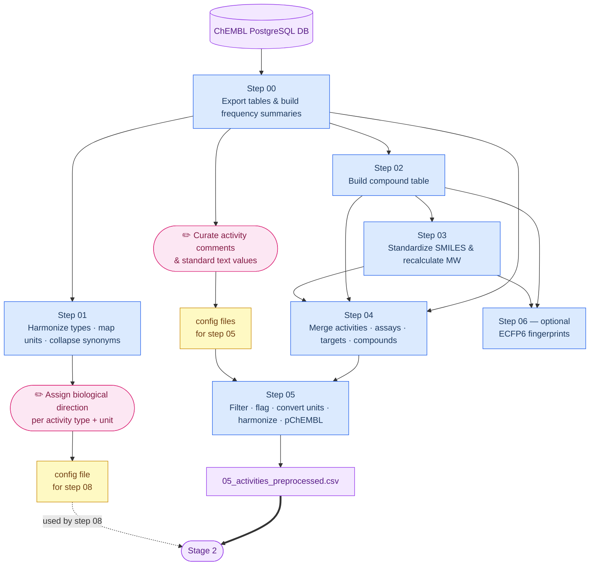

# Pipeline design notes

Detailed design rationale, methodology, and reference tables for the ChEMBL antimicrobial pipeline.
[`scripts/README.md`](../scripts/README.md) is the concise per-step overview (one line + key decisions);
this document holds the longer-form design detail that used to live inline there. Per-step inputs/outputs
are documented in each script's docstring.

---

## Stage 1 — Process ChEMBL (00–06)

### Step 00 — Export ChEMBL activities

Exports the raw ChEMBL tables (`activities`, `assays`, `assay_parameters`, `activity_stds_lookup`,
`bioassay_ontology`, `compound_structures`, `docs`, `molecule_dictionary`, `target_dictionary`,
`target_components`, `component_synonyms`, `component_sequences`, `source`) into `data/chembl_activities/`.
See the [ChEMBL schema documentation](https://ftp.ebi.ac.uk/pub/databases/chembl/ChEMBLdb/latest/schema_documentation.txt).

It also derives frequency/reference tables into `output/stage1/`:

1. `00_activity_comments.csv` — frequency of `activity_comment` values (e.g. `"active"`)
2. `00_activity_std_units.csv` — frequency of (`standard_type`, `standard_units`) pairs (e.g. `"IC50 / nM"`)
3. `00_standard_units.csv` — frequency of `standard_units`
4. `00_standard_text.csv` — frequency of `standard_text_value` (e.g. `"Compound metabolized"`)
5. `00_assay_descriptions.csv` — assay IDs → text descriptions + ChEMBL IDs (from `ASSAYS`)
6. `00_target_dictionary_synonyms.csv` — target dictionary with component synonyms collapsed (used by step 09)

`00_activity_comments.csv` and `00_standard_text.csv` were manually reviewed to label the most frequent
entries → `config/activity_comments_manual_curation.csv` and `config/standard_text_manual_curation.csv`
(`manual_curation_activity`: `1` = active, `-1` = inactive, `0` = inconclusive).

### Step 05 — Clean activities (procedure)

Produces `output/stage1/05_activities_preprocessed.csv` via:

1. **Filter invalid entries** — drop activities with missing canonical SMILES.
2. **Flag activity comments** — map `activity_comment` → active(1)/inactive(-1)/unknown(0) via `config/activity_comments_manual_curation.csv`.
3. **Flag standard text** — same for `standard_text_value` via `config/standard_text_manual_curation.csv`.
4. **Convert units and values** — normalise unit strings; convert raw values with formulas from `config/ucum_manual.csv`.
5. **Standardize relations** — map `>=`, `>>`, `~` etc. to `>`, `<`, `=`; missing (`NaN`) relations become `=`.
6. **Calculate pChEMBL** — `pchembl_calculated` for `unit = umol.L-1` records; zeros replaced with 1e-10 before log, result clipped to `[1, 9]`; the ChEMBL-provided `pchembl` is retained alongside.
7. **Convert doc IDs** — `doc_id` → `doc_chembl_id`.
8. **Harmonize activity types** — strip punctuation/spaces, uppercase `standard_type`.
9. **Map synonyms** — collapse variants to canonical names via `config/synonyms.csv`.
10. **Create text flag** — merge comment + standard-text flags into one `text_flag` (1 / -1 / 0).

### Data-flow diagram



---

## Stage 2 — Per-pathogen preparation (07–12)

### Step 07 — Get pathogen assays

Matching is by case-insensitive text search on `target_organism` and `assay_organism`. Assay IDs in
`config/assays_to_include/<code>.csv` are added regardless of organism match (for assays the name filter
misses — e.g. annotated under a strain name); IDs in `config/assays_to_exclude/<code>.csv` are then
removed (incorrectly-annotated or unsuitable assays). Both files are one ChEMBL assay ID per line, no
header; missing files are ignored.

### Step 08 — Clean pathogen activities (filter order)

1. Remove compounds with no SMILES.
2. Remove empty activities (no numeric value and zero `text_flag`).
3. Keep only units present in `output/stage1/01_activity_std_units_converted.csv` (or no unit).
4. Assign direction (−1/0/+1) per (activity_type, unit) from `config/activity_std_units_manual_curation.csv`.
5. Remove unmodelable activities (no/unclear direction **and** no active/inactive text flag).

### Step 09 — Curate assay parameters (LLM)

> Requires a GPU machine with [ollama](https://ollama.com/) running locally. Model set by `LLM_MODEL`.

For each (`assay_id`, `activity_type`, `unit`) triplet the LLM returns strict JSON:
`assay_organism_curated`, `target_type_curated`, `target_name_curated`, `target_chembl_id_curated`,
`assay_strain_curated`, `atcc_id`, `mutations`, `known_drug_resistances`, `culture_media`. Assays are
processed in batches of 6; the intermediate `09_assays_parameters.csv` is appended incrementally so a run
resumes on restart, then merged into `09_assays_parameters_full.csv`. On LLM failure an empty row is
written and processing continues.

#### Two-track processing: Group A and Group B

Assays are classified before any LLM call, by how much inference is required.

**Group A (text extraction only)** — assays whose ChEMBL target type is already reliable
(`SINGLE PROTEIN`, `PROTEIN COMPLEX`, `PROTEIN FAMILY`, `SUBCELLULAR`, or non-biological types like
`ADMET`/`NUCLEIC-ACID`/`TISSUE`/`SELECTIVITY GROUP`/`UNDEFINED`/`UNKNOWN`), plus `ORGANISM`/organism-BAO
assays where the assay organism matches the pathogen. These get `target_type_curated`,
`target_name_curated`, `target_chembl_id_curated` **pre-filled deterministically**:

| ChEMBL target type | `target_type_curated` | `target_chembl_id_curated` |
|---|---|---|
| `SINGLE PROTEIN` / `PROTEIN COMPLEX` / `PROTEIN FAMILY` | kept as-is | from ChEMBL |
| `SUBCELLULAR` | `SUBCELLULAR` | from ChEMBL |
| `ADMET`, `NUCLEIC-ACID`, `TISSUE`, `SELECTIVITY GROUP`, `UNDEFINED`, `UNKNOWN` | `DISCARDED` | cleared |
| `ORGANISM` / ambiguous + organism-BAO matching pathogen | `ORGANISM` | hardcoded per-pathogen ID (below) |

The LLM is then called only for the text fields. Exception: a protein target type with
`target_chembl_id = CHEMBL612545` ("Unchecked") is routed to Group B.

**Group B (full inference)** — ambiguous types (`UNCHECKED`/CHEMBL612545, `NON-MOLECULAR`,
`NON-PROTEIN TARGET`). LLM rules embedded in the prompt:
- assay organism matches pathogen **and** phenotypic/growth-based → `ORGANISM`
- description names a specific protein → `SINGLE PROTEIN`; ID left empty, resolved in Python (below)
- assay organism is a human cell line (e.g. cytotoxicity) → `assay_organism_curated = Homo sapiens`
- `assay_type = Binding` + `UNCHECKED` → only `SINGLE PROTEIN` or `DISCARDED`, never `ORGANISM`
- `DISCARDED` if not a bioactivity assay, or if both a target name/ID and an organism/cell-line are absent

#### Hardcoded organism ChEMBL ID mapping

| Pathogen | ChEMBL ID | | Pathogen | ChEMBL ID |
|----------|-----------|-|----------|-----------|
| Mycobacterium tuberculosis | CHEMBL360 | | Candida albicans | CHEMBL366 |
| Acinetobacter baumannii | CHEMBL614425 | | Plasmodium falciparum | CHEMBL364 |
| Escherichia coli | CHEMBL354 | | Campylobacter | CHEMBL612492 |
| Pseudomonas aeruginosa | CHEMBL348 | | Helicobacter pylori | CHEMBL612600 |
| Klebsiella pneumoniae | CHEMBL350 | | Neisseria gonorrhoeae | CHEMBL614430 |
| Streptococcus pneumoniae | CHEMBL347 | | Enterobacter | CHEMBL614439 |
| Enterococcus faecium | CHEMBL357 | | Staphylococcus aureus | CHEMBL352 |
| | | | Schistosoma mansoni | CHEMBL612893 |

#### Target ChEMBL ID resolution (SINGLE PROTEIN, Group B)

The LLM extracts the protein name and leaves the ID empty; it is resolved against the ChEMBL target
dictionary by a **multi-strategy exact-match lookup**: (1) direct case-insensitive match, (2)
organism-prefix stripping, (3) slash-split of the full name, (4) prefix-strip + slash-split, (5)
GyrA/B-style gene-name reconstruction, (6) token-level slash split (e.g. `"DNA GyrA/B heterotetramer"`).
**IDs are never guessed** — unresolvable names are left blank.

### Steps 10–11

- **10 — assay clusters:** unique compound SMILES per (`assay_id`, `activity_type`, `unit`) clustered with
  BitBirch on ECFP4 (2048-bit) at Tanimoto **0.3 / 0.6 / 0.85** — a chemical-diversity measure.
  Independent of step 09 (parallelisable).
- **11 — assay overlap:** pairwise compound overlap between assays treated as
  (`assay_id`, `activity_type`, `unit`, `doc_chembl_id`) 4-tuples, only for assays with **≥ 50 compounds**;
  overlap ratio = shared / size-of-smaller (1.0 = smaller fully contained), plus a same-document flag.

### Step 12 — eos1klk embeddings

Runs the Ersilia `eos1klk` model (`lazychemvis-reference-library`) once over the deduplicated SMILES of
every pathogen (`07_all_smiles.csv`), concatenated into one cross-pathogen union (556,004 unique vs
897,186 summed at time of writing). Output is HDF5 to keep the wide embedding compact. `BATCH_SIZE = 1000`
controls the resumable chunk size; resumable intermediates are deleted once the consolidated `.h5` is
complete (kept if a run fails before the merge, so a re-run resumes).

---

## Stage 3 — Conservative pooling (13–20)

### Step 13 — Prepare assay datasets

Each assay is processed through **quantitative** (numeric) and **qualitative** (text-flag) paths, then
classified as one dataset type per (`assay_id`, `activity_type`, `unit`, `expert_cutoff`).

**Target-type curation.** The LLM `target_type_curated` is collapsed into `target_type_curated_extra` ∈
{`SINGLE PROTEIN` (also captures PROTEIN COMPLEX/FAMILY), `ORGANISM`, `DISCARDED`}. Collapse rules:
`UNCHECKED` accepts ORGANISM/SINGLE PROTEIN/DISCARDED (else → DISCARDED); `NON-MOLECULAR` accepts only
ORGANISM/DISCARDED (SINGLE PROTEIN → DISCARDED); `SUBCELLULAR` and everything else → DISCARDED. This field
is the key for expert-cutoff lookup.

**Expert cutoffs.** From `config/expert_cutoffs.csv`, keyed by (`activity_type`, `unit`,
`target_type_curated_extra`, `pathogen_code`); multiple cutoffs per key (semicolon-separated) → one dataset
per cutoff. Cutoffs are defined in the canonical unit space from step 05 (e.g. IC50 in `umol.L-1`), so
per-unit (nM/µM) entries are not needed. **Percentage endpoints** (`unit == "%"`: ACTIVITY, INHIBITION,
GI, PERCENTEFFECT) use `50;75;90` — a 25% effect was judged too weak to call active, so the floor was
raised to 50%, which remains the preferred default in selection (steps 15/17).

**Quantitative binarization.** (1) censored measurements on the wrong side of the direction are reset to
the assay extreme with relation `=`; (2) per compound, keep the most active record (min for direction −1,
max for +1); (3) `bin = 1` iff `value ≤ cutoff` (−1) or `value ≥ cutoff` (+1).
**Qualitative binarization** from `text_flag`, aggregated per compound (priority `1 > −1 > 0`; conflicting
active+inactive raises; neutral-only compounds dropped).

| Type | Condition | File suffix |
|------|-----------|-------------|
| `quantitative` | numeric + direction + cutoff, no qualitative | `_qt_<cutoff>.csv.gz` |
| `qualitative` | text flags only, or no cutoff/direction | `_ql.csv.gz` |
| `mixed` | both quantitative and qualitative | `_mx_<cutoff>.csv.gz` |
| `none` | numeric but no cutoff/direction, no qualitative | — |

For **mixed** datasets, qualitative inactives not already present are appended to the quantitative set;
qualitative actives without a numeric measurement are excluded (to avoid inflating the active class).

### Step 14 — Individual light modeling

RandomForest (100 trees) on Morgan/ECFP fingerprints. Two mutually-exclusive conditions, evaluated on the
**quantitative portion** (`cpds_qt`/`pos_qt`/`ratio_qt`):

| | Condition A | Condition B |
|--|-------------|-------------|
| Min compounds | ≥ 1,000 | any |
| Min actives | ≥ 50 | ≥ 100 |
| Active ratio | < 0.5 | ≥ 0.5 |
| Decoys | none (negatives downsampled if ratio < 5%) | ChEMBL decoys added to 10% active ratio |

Assignment is hierarchical across **all** cutoffs: A if any cutoff meets A criteria; only assays failing A
at every cutoff are considered for B. Per assay: (optionally add decoys) → downsample negatives if ratio
< 5% → 4-fold stratified CV → mean AUROC ± std → final model on all data → predict the reference set.

**Reference set.** Up to **10,000 compounds never screened against the pathogen**, drawn from all ChEMBL
compounds with fingerprints (seed 42). Pathogen-naive compounds avoid data leakage: correlations reflect
shared biology, not shared training data. (Pathogen-tested compounds were rejected — many appear in the
training sets of the models being compared, which would make correlations reflect memorization.)

### Steps 15 / 17 — Dataset selection

Keep only assays/groups with **best AUROC > 0.70** (`AUROC_MIN_THRESHOLD`, across all cutoffs). Choose one
cutoff: **prefer the reference cutoff** (mid value for most endpoints; the most-lenient 50 for `%`
endpoints — see `reference_cutoff()` in `src/pathogen_utils.py`); **switch to the best cutoff** only if it
beats the reference by > 0.10 (`AUROC_IMPROVEMENT_THRESHOLD`); **fall back to best** if the reference has no
modeled result. `is_mid_cutoff` records which rule fired. The 0.70 gate is on the *best* cutoff, so a
selected reference-cutoff dataset can have AUROC < 0.70. Step 15 skips assays with < 2 cutoffs; step 17
does not (single-cutoff groups use the only cutoff).

### Step 16 — Merged light modeling

Rescues assays not accepted in step 15 by merging context-compatible assays into larger datasets. Only
quantitative/mixed assays contribute (qualitative-only excluded).

**Merge candidate identification** (two independent strategies):
- **ORGANISM** — split into *strain-known* (group by activity_type/unit/direction/assay_type/
  target_type_curated_extra/`assay_strain_norm`) and *NaN-strain* (same without strain).
- **SINGLE PROTEIN** — group by …/`bao_label`/`assay_strain_norm`/`target_chembl_id_curated`; assays
  without a curated target ID are excluded.

A group passes the pre-filter with ≥ 2 assays and a compound union ≥ 100.

**Fractional-contribution filter.** Each assay must be ≥ 5% of the group's compound union (pass 1).
Rejected assays are re-tried among themselves (pass 2, `_r` suffix) if they form a ≥ 2-assay group each
≥ 5% of the rescue union. **Post-merge**: keep most-active per compound (min −1 / max +1); append
qualitative inactives; require ≥ 1,000 compounds (ratio < 0.5) or ≥ 100 (ratio ≥ 0.5); skip groups with
≤ 50 positives; add decoys to 10% if ratio > 0.5. Merged datasets named `M_ORG<i>` / `M_SP<i>` (`_r` for
rescue) + activity type + cutoff (e.g. `M_ORG0_MIC_10.0`).

#### `failure_reason` labels (`16_merging_analysis.csv`)

Override rules: (1) failure labels overwrite only the `group_qualified` placeholder, not each other; (2)
`successfully_merged` overwrites any prior failure and is never downgraded.

| Label | Stage | Meaning |
|-------|-------|---------|
| `insufficient_compatible_assays` | Pre-filter | group has < 2 compatible assays |
| `insufficient_compounds_after_merging` | Pre-filter | ≥ 2 assays but compound union < 100 |
| `insufficient_fractional_contribution` | Fractional | < 5% of union in both passes, or rescue sub-group < 2 |
| `group_qualified_pass1` | Fractional | sole assay passing 5% in pass 1 — no partner |
| `group_qualified_pass2` | Fractional | sole assay passing 5% in the rescue sub-group |
| `insufficient_compounds_after_merging_pass1` / `_pass2` | Post-merge | merged compound count below the 1,000/100 minimum |
| `insufficient_positives_after_merging_pass1` / `_pass2` | Post-merge | ≤ 50 actives after merging |
| `excluded_pubchem_assay` | Pre-filter | has a PubChem counterpart (`config/pubchem_aids/`); modelled separately |
| `excluded_no_target_chembl_id` | Pre-filter | SINGLE PROTEIN with no curated target ID |
| `no_expert_cutoff` | Pre-modeling | no `expert_cutoffs.csv` entry for the group |
| `successfully_merged` | Modeling | contributed to a modeled merged dataset (`merged_group_name`, `auroc` recorded) |

#### Strain normalization (`assay_strain_norm`)

Merging groups on a *normalized* strain key rather than raw `assay_strain_curated`, because the same
strain appears under many spellings (`BAA-1605` / `BAA 1605` / `ATCC BAA1605`). Built on the fly (step 09 /
the LLM is never touched) by `strain_norm_key()` in three layers:

1. **`normalize_strain`** — uppercase, strip culture-collection acronyms (`STRAIN_CATALOG_PREFIXES` in
   `src/default.py` — ATCC, DSM, NCTC, MTCC, CIP, … **plus WHO/FDA**), and remove spaces/hyphens/dots/
   underscores/slashes. So `ATCC 25922` ≡ `NCTC 25922` ≡ `25922`; `WHO X` ≡ `WHO-X` (the `X` designator is
   preserved — only the acronym is stripped). A numeric acronym is folded only when a number follows it
   (optionally after a short letter sub-series, so `ATCC BAA-1605` → `BAA1605`).
2. **ATCC fallback** — identity in step 09 is split across `assay_strain_curated` (name) and `atcc_id`
   (number); when the name is empty the key falls back to `normalize_strain(atcc_id)` (~8,500 assays
   rescued). Safe because it only matches an ATCC number to an existing same-number key.
3. **Curated alias map** — resolves the layer-1/2 key to one canonical strain using
   `config/strains/strain_equivalences_<pathogen>.csv` (`load_strain_equivalences()`). The only layer that
   can unify a **name with its number** (`H37Rv` = `ATCC 27294` = `ATCC 25618`) and **numbers across
   collections** (`ATCC 25922` = `DSM 1103` = `KCTC 1682`). Built by `tools/build_strain_equivalences.py`
   from the **BacDive** API plus a curated seed `config/strains/strain_equivalences_manual.csv` (manual
   rows take precedence). Each row: `member_key` → `canonical_label` with `match_type`:
   - `exact` — one normalized base key (common case);
   - `contains` — substring of the base key (e.g. any `…BCG…` → `BCG`);
   - `prefixed` — match the value *with* its acronym (e.g. `LMG17978`); the **only** way to *separate* two
     strains sharing a number across collections (applied before `exact`/`contains`).

   **Decisions:** `canonical_label` is the ATCC ID when the group has one; BCG lumps named substrains
   (`contains`); NCTC 8325 kept separate from derivative SA113/ATCC 35556; confirmed same-number/
   different-collection clashes split with `prefixed` (`LMG 17978` ≠ `ATCC 17978`; `ATCC 12-1` ≠
   `MTCC 121`). Clashes surfaced by `tools/strain_collision_audit.py`. Pathogens with no source (e.g.
   *P. falciparum*, *S. mansoni*) are a clean no-op. `assay_strain_norm` is only a grouping key — raw names
   are never altered; a merged group is labelled with the most common original `assay_strain_curated`, and
   the key is carried into the master table (step 19) and the diagnosis strain count (step 20).

### Step 18 — Evaluate dataset correlations

Pairwise similarity between all selected **ORGANISM** datasets (A/B from 15, M from 17), then greedy dedup.
SINGLE PROTEIN datasets are modeled earlier but excluded from final selection (phenotypic whole-organism
assays are the endpoint of interest); they remain in the master table with status annotated.

Similarity is computed from predictions on the reference set (10,000 pathogen-naive compounds): `spearman`
(rank correlation), `hit_overlap_1000` / `hit_overlap_100` (top-K overlap above chance), and
`compound_overlap` (Jaccard-like training-compound overlap, normalised by the smaller set). The full N×N
matrix is stored (both directions + diagonal) to keep the dedup lookup simple.

**Greedy dedup:** datasets sorted by label (A → B → M), then size descending, processed greedily; a dataset
is discarded iff it is simultaneously model-correlated **and** compound-overlapping with an already-selected
dataset:
```
(spearman + hit_overlap_1000 + hit_overlap_100) / 3 > CORRELATION_THRESHOLD   (default 0.5)
AND compound_overlap > CORRELATION_THRESHOLD
```
The `AND` matters: high model correlation alone does not discard — two correlated models on different
compounds may capture the same biology across different chemical series (informative, not redundant).

### Step 19 — Prepare assay master table

One row per (`assay_id`, `activity_type`, `unit`) triplet, merging: `08_assays_cleaned.csv` (base
metadata), `09_assays_parameters_full.csv` (LLM fields), `10_assays_clusters.csv` (diversity),
`13_assay_data_info.csv` + `13_datasets.csv` (dataset types, ratios), `config/expert_cutoffs.csv`
(`evaluated_cutoffs`), `14_individual_LM.csv` (`evaluated_aurocs`), `16_merging_analysis.csv` (failure
reasons), `data/chembl_activities/` (`uniprot_accession`), and optionally `config/pubchem_aids/`.

Selection columns: `selected`, `selected_cutoff`, `selected_label`. Free-text `comment_A` / `comment_B` /
`comment_M` annotate each assay's journey (e.g. *"Not considered for A: insufficient compounds (47, need
≥1000)…"*, *"Modeled but not selected: best AUROC 0.623 below 0.70"*, *"Discarded: high correlation with
M_ORG0_MIC_1.0"*, *"Retained in final selection"*).

### Step 20 — Diagnosis

Adaptive layout: **2×2** (4 panels) when nothing is selected yet, **3×3** (9 panels) once ≥ 1 dataset is
selected.

1. **Raw vs cleaned** — grouped bars of activities/compounds/assays before vs after cleaning.
2. **Data classification** — stacked fractions across assay type (F/B/other), target type (ORG/SP/other),
   strain (majoritarian/other/none), unit (µM/`%`/other), activity type (quant-only/mixed/other).
3. **tSNE** — 2D embedding of Morgan FPs; ≤10k pathogen-tested compounds colored by density over 3× grey
   background ChEMBL compounds (PCA-16 pre-step).
4. **Chemical-space coverage by assay** — dual-axis log–log: compounds/assay and cumulative fraction of
   pathogen chemical space as assays are added.
5. **Compound-overlap heatmap** — pairwise overlap between selected ORGANISM models, hierarchically
   clustered ([0,1]).
6. **Top-100 hit-overlap heatmap** — same layout, top-100 reference hit overlap.
7. **Coverage by label** — fraction of chemical space covered per label (A/B/M) and combined.
8. **Compounds vs positives** — log–log scatter per selected dataset, colored by label.
9. **Assay rejection reasons** — stacked bars per label of the pipeline-status category each assay triplet
   falls into (categories: `selected`, `already_accepted`, `non_organism`, `qualitative_only`,
   `no_activity_data`, `no_cutoff`, `insufficient_compatible`, `fractional_contribution`,
   `group_qualified`, `too_few_compounds`, `too_few_positives`, `ratio_out_of_range`, `auroc_below`,
   `correlation`, `other`).

`20_summary_table.xlsx` has four sheets: Pipeline Funnel, By Condition, By Activity-Unit, Rejection Reasons.

---

## Stage 4 — Signal-based pooling (21–28)

A redesigned, simpler curation producing **fewer, larger** datasets (one per `(assay_id, activity_type)`)
instead of the A/B/M per-assay datasets. Reads only Stage-2 outputs (07/08/09), so it is independent of
Stage 3. **All Stage-4 figures share one publication house style** (`src/plot_base.py`, stylia
`print`/`article`) and pull colours from a shared semantic map (`src/plot_colors.py`: DR = cobalt,
SP = tangerine, active = crimson, inactive = silver).

### Step 21 — Build curated datasets

The unit of work is `(assay_id, activity_type)`, **not** the triplet: step 05's UCUM conversion already
collapses each numeric activity_type to one canonical unit, so `unit` is redundant for keying (numeric
pairs span > 1 unit in ~0% of cases) and is kept only to assign a category; a pair whose numeric records do
span > 1 unit is flagged `MULTI_UNIT` and discarded. Molecules are compared by **InChIKey**; intra-pair
dedup keeps the single most active record (min for −1, max for +1), reusing step-13 censored-relation
handling.

Filters (first failure recorded; all pairs stay in the summary): (1) keep only
`target_type_curated_extra == ORGANISM`; (2) quantitative only (text-only pairs discarded); (3) discard
`MULTI_UNIT`; (4) discard `source_label == 'COADD'` and PubChem-superseded assays; (5) **discard pairs with
≤ 5 unique molecules** in the written dataset (`MIN_MOLECULES = 5` — below this a binary dataset is too
small to model/evaluate).

**Recovered qualitative inactives** (curator decision): within a retained pair, an InChIKey with no numeric
record is carried in as an **inactive** iff its qualitative records are purely inactive (`text_flag == -1`,
no active flag). Any active flag with no value → discarded (cannot be placed on the active side without a
measurement). Recovered inactives count toward the ≥5 threshold and are written with `value`/`relation` =
NaN. This reverses the prior silent loss of text-only inactives, which had inflated active ratios and made
some mixed datasets look degenerate. Counts recorded as `n_recovered_inactive` /
`n_text_only_active_discarded`; written size as `n_mol_dataset`.

**Activity category** from `config/activity_type_categories.csv`, keyed by `(activity_type, unit)`:
**DR** = concentration endpoints in `umol.L-1` (MIC, IC50, MIC90/50/80, EC50, IC90, ED50, AC50, CC50, GI50,
POTENCY, LC50, ACTIVITY); **SP** = single-point (`%`: INHIBITION, ACTIVITY, GI, SURVIVAL, MORTALITY,
EFFICACY, PERCENTEFFECT; `mm`: IZ). `ACTIVITY` is in both, split by unit. Anything unlisted →
**UNCATEGORIZED** (retained, flagged, excluded from binarisation/pooling — not silently dropped). The
explicit list keeps out binding constants (KI/KD), unit-mass endpoints (ug.mg-1), and ambiguous types
(EMAX, %CONTROL).

### Step 22 — Binarise datasets

Conservative, qualifier-aware **"prove-the-hit"** binarisation (`dataset_utils.binarize_conservative`) of
DR/SP datasets (UNCATEGORIZED skipped). Cutoff value keyed by unit from `config/category_cutoffs.csv`
(`µM→10`, `%→50`, `mm→20`); direction read from the dataset. Active (1) only when the measurement *proves*
the active side — `direction -1`: `relation ∈ {=,<}` and `value ≤ cutoff`; `direction +1`: `relation ∈
{=,>}` and `value ≥ cutoff`. Censored records that could straddle the cutoff (e.g. `MIC > X` with `X <
cutoff`) are labelled **inactive**, not guessed.

**Rationale:** step 21's censoring handling can otherwise push a non-inhibitor to a dataset extreme below
the cutoff and mislabel it a hit (~0.5–1% of labels; 33–69% of ambiguous DR records were labelled active
before this change). Step 21 preserves the surviving record's qualifier
(`dedup_most_active_by_inchikey(..., preserve_qualifier=True)`) so `relation` reaching step 22 is real.
Recovered qualitative inactives (value/relation NaN) are always inactive. **Degenerate** datasets
(all-active/all-inactive) are kept + flagged (24–57% per pathogen); the pooling phase decides what to use.

### Step 23 — Transfer signal and pool building

Strategy-B core: for each pathogen × category, train a RF on each binarised dataset A and score AUROC on
every other dataset B's **disjoint** molecules (a true generalisation test); "A predicts B well" is the
evidence for pooling. Directional; pairs with too few disjoint test molecules are NaN.

**Near-duplicate folding (pre-transfer).** All datasets (incl. degenerate/small) are folded when
near-duplicate: edge iff containment `|A∩B|/min(|A|,|B|) ≥ 0.90` and shared-label discordance `< 0.20`
(`NEAR_DUP_OVERLAP=0.90`, `NEAR_DUP_DISCORD=0.20`). This closes a blind spot — the transfer test needs
disjoint molecules, so near-identical datasets would never link and would fragment into singletons.
Folding reduces the dataset count ~28–36% with negligible chaining.

**Pool building.** The bidirectional transfer graph at **AUROC ≥ 0.75** is clustered with **greedy
modularity**, each community merged to one row/molecule.
- **`POOL_RULE=bidirectional`, `POOL_THRESHOLD=0.75`, greedy modularity** — chosen empirically on the dev
  organisms. Connected components percolate into one blob; unidirectional edges also collapse; greedy
  modularity never leaves a 100% blob and picks the pool count automatically. **MCL** (inflation sweep) was
  tried on saureus/mtuberculosis and gave no advantage (best case only reproduces greedy modularity; higher
  inflation fragments), so greedy modularity was kept.
- **`MIN_DATASET_SIZE = 20`** — a dataset enters only if non-degenerate and ≥ 20 molecules (also the O(n²)
  tractability lever); sub-threshold/degenerate datasets stay out (folded in later).
- **`MIN_TEST = 5`** — minimum disjoint test molecules to score a transfer cell.

**Label resolution when merging (per molecule):** average raw values within the same (unit + direction) and
re-binarise against the category cutoff (dissolves ties). **DR averages across activity types** (MIC/IC50/
EC50, all µM) — signed off. **Cross-unit SP** (% and mm): **% prevails** (rare). Re-binarisation is
qualifier-aware (conservative), mirroring step 22, so a single-dataset merge reproduces the stored bins
exactly. The same `pooling_utils.merge_datasets` is used for folding, pools, and (step 25) leftovers.

**Model:** RF (100 trees) on Morgan r=3 / 2048-bit, seed `RANDOM_SEED`. **Cache:** the transfer matrix is
cached at `23_transfer/23_transfer_<cat>_o<ov>d<disc>.npz` (fold settings embedded in the name); reuse is
**manual** — an existing npz is loaded with no staleness check (delete it or pass `--force` to recompute).
Per-pathogen runs pass `--skip-general`; cross-pathogen figures are rebuilt once via `--general-only`.

### Step 24 — Cross-validate pools & Youden cutoff

Models every step-23 pool worth modelling: every multi-dataset pool, plus any singleton screen with
**≥ 200 molecules** (`SINGLETON_MIN_MOLECULES`) that is CV-able (both classes, ≥ 5 each). RF(100) on Morgan,
**5-fold stratified CV** (80/20), plain (no decoys); OOF probabilities pooled into one ROC → CV **AUROC** +
**Youden-index** cutoff (+ sensitivity/specificity). The 200-molecule floor was chosen over a
chemical-space-% gate because a % threshold still admits ~20-molecule datasets in small-chem-space
pathogens.

### Step 25 — Merge leftovers into modelled pools

Folds the **leftovers** (non-modelled singletons, degenerate single-class, small < 20-mol datasets) into
the pool whose model best explains them, without disturbing existing pool molecules. Per pathogen/category
with ≥ 1 modelled pool: (1) train a final RF per pool; (2) dedup each leftover against molecules already
pooled; (3) assign each leftover to the pool with the highest **balanced accuracy** at that pool's Youden
cutoff (single-class-safe — AUROC cannot score degenerate/small sets); (4) batch per pool — append the
assigned residuals, re-CV once, accept iff grown AUROC ≥ baseline − **`AUROC_TOL`**.

**Key decision:** `AUROC_TOL = 0.05` — chosen over a stricter 0.005 to trade ≤ 0.05 AUROC for large
coverage gains; the guard still blocks genuine degradations (0.06–0.13 drops). **Result (all 15):** mean
chemical-space coverage rises to **~98%** (DR and SP), and pool AUROCs *improve* on merging (mean +0.075 on
accepted batches) as the added, chemically-diverse, mostly-inactive leftovers enrich the negative space.

**Caveat — pools are not disjoint.** A molecule tested in assays that land in different pools can belong to
several pools and even carry different bins in each; this is inherent to the per-pool design (each pool is a
self-contained task), pre-exists in step 23, and is amplified by folding leftovers. It is *not* corrected —
`25_label_conflicts.csv` reports its extent (per category: unique molecules, # in > 1 pool, # with
conflicting labels). Leftover assignment also scores balanced accuracy over the leftover's full molecule set,
so a pool that already contains some of those molecules scores them in-sample (slightly optimistic).

### Step 26 — Low-data catch-all pools

For categories where steps 23–25 build no modelled pool (no multi-dataset cluster, no ≥200-molecule
singleton), merge **all** the category's datasets into one catch-all (same conservative merge), CV it
(5-fold RF/Morgan), and keep it only if it clears a quality bar. **Key decision:** keep iff **AUROC ≥ 0.70
and ≥ 50 molecules** (and CV-able, ≥ 5/class); else the category is documented as insufficient data (raw
datasets remain in `22_binarised/`). Of the 9 deferred categories, 5 are recovered (abaumannii SP,
campylobacter DR, enterobacter SP, ngonorrhoeae DR, spneumoniae SP); 4 stay un-modellable (efaecium SP &
hpylori SP too weak, campylobacter SP & ngonorrhoeae SP too small).
